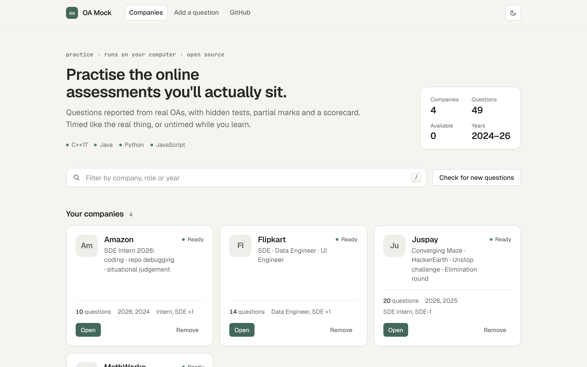
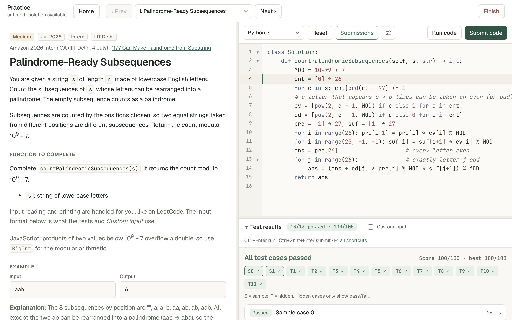
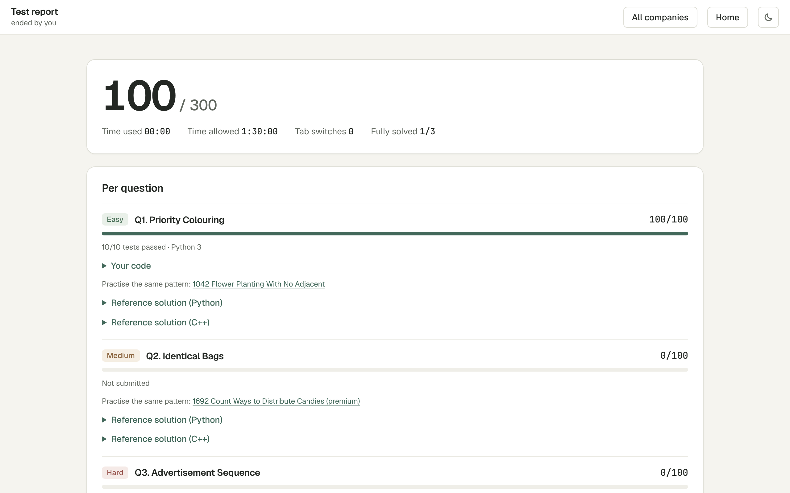
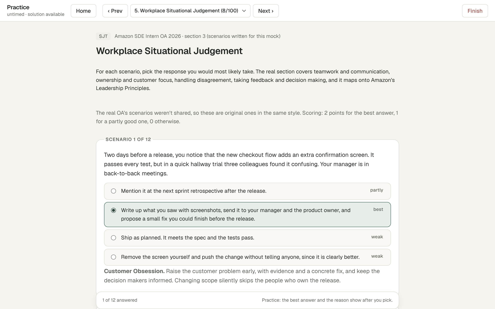
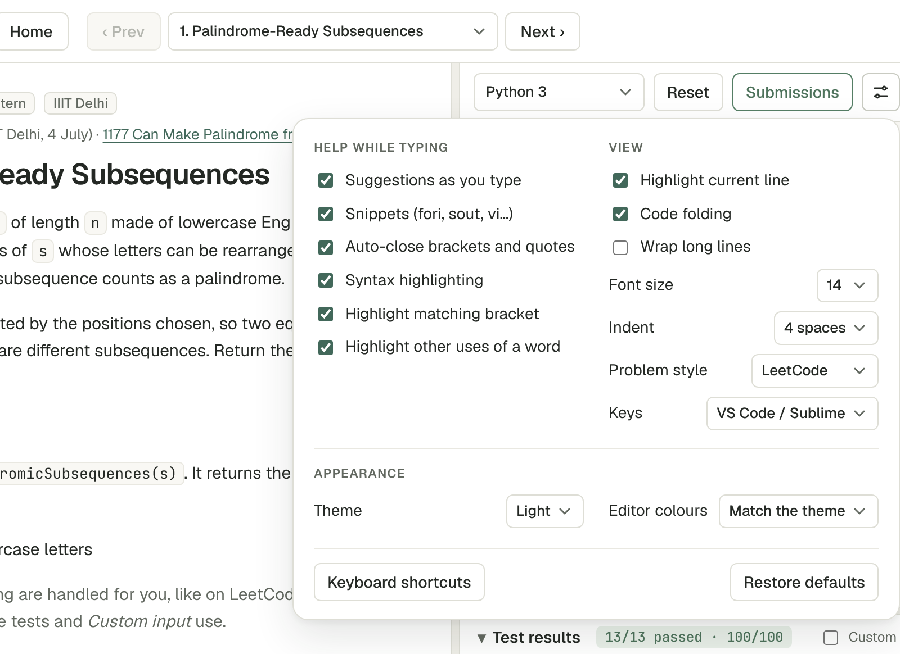
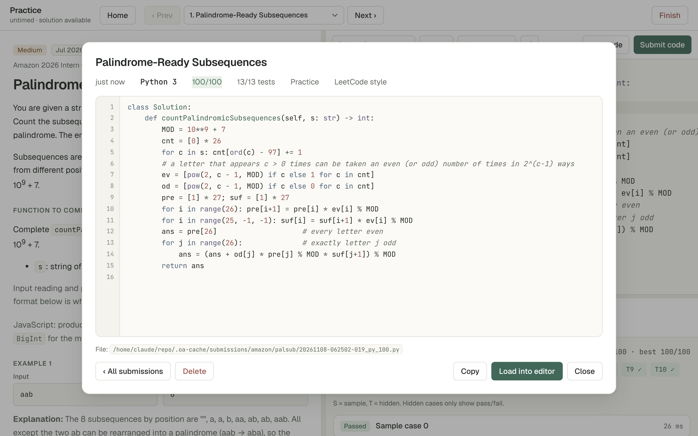
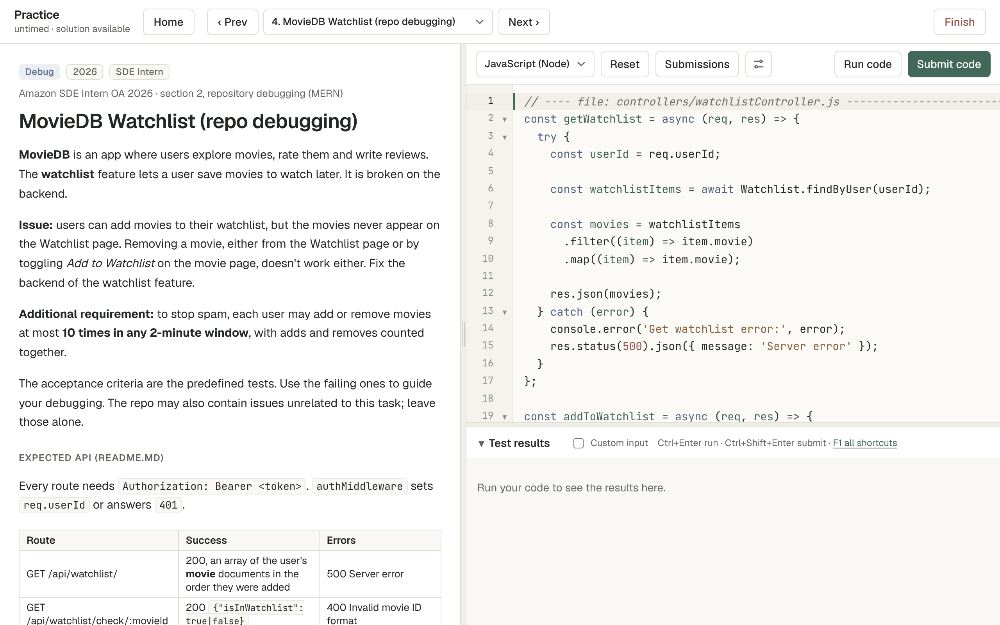

# OA Mock

**Practice online assessments for Flipkart, Juspay, Amazon and MathWorks on your own computer.** The tests use questions reported from real OAs, with hidden test cases, HackerRank-style partial marks and a scorecard at the end. You can sit a test timed or untimed.



- **Real formats:** each company's test layout is reproduced (for example, Amazon's 3-section SDE Intern OA), or you can build a custom set. The question bank is grouped by year, with filters for role, college and difficulty.
- **LeetCode or HackerRank style:** by default you complete a function and the input/output is handled for you. Switch to HackerRank style (on the company page or in the editor settings) to get the whole program, input reading included.
- **Your languages:** C++17, Java, Python 3 and JavaScript compile and run natively on your machine.
- **Graded like the real thing:** Run checks the samples, and Submit runs every hidden test. Score = tests passed / total × 100, and your best submission counts. Hidden tests only show pass/fail, except the first one that fails: you can see it, load it as custom input, or download its input and expected output as text.
- **Timed or not:** a countdown that auto-submits, or **No timer** with a count-up clock.
- **Learn afterwards:** the report shows your code, reference solutions (Python + C++) and a LeetCode question with the same pattern.
- **Every submission kept:** each Submit is saved on your computer in `.oa-cache/` (git-ignored). Browse them per question or from the home page, and reopen any of them in the editor.
- **A real editor:** smart indentation, suggestions and snippets as you type, VS Code/Sublime shortcuts (multi-cursor, move/duplicate lines, toggle comment), find/replace, code folding, and an optional Vim mode. Each feature can be switched on or off.
- **Private:** no account, no camera, no proctoring. The runner only listens on `127.0.0.1`, and history is saved in your browser.

---

## Quick start

One command downloads the app with Flipkart's questions (about 4 MB) into an `oa-mock` folder, installs what's missing and opens it:

| OS | Install (first time) | Start (after that) |
|---|---|---|
| **macOS** | `curl -fsSL https://raw.githubusercontent.com/rgabhi/oa-mock/main/scripts/install.sh \| bash` | `oa-mock` in a terminal, or double-click **`Start OA Mock.command`** in the `oa-mock` folder |
| **Linux** | the same command | `oa-mock` in a terminal (or `./start.sh` in the folder) |
| **Windows 10/11** (PowerShell) | `irm https://raw.githubusercontent.com/rgabhi/oa-mock/main/scripts/install.ps1 \| iex` | double-click **`start.bat`** in the `oa-mock` folder, or `oa-mock` in a terminal |

The `oa-mock` command works in any new terminal window after setup. Stop the mock with **Ctrl+C**.

In the `oa-mock` folder, the only things you use are the start files and the README:

```
oa-mock/
  Start OA Mock.command    macOS: double-click to start
  start.sh / start.bat     start (Linux and macOS / Windows)
  README.md, CONTRIBUTING.md
  app/        the app itself (server and web pages)
  data/       the question banks, one folder per company
  scripts/    setup and install scripts
  tools/      checks for contributors
  docs/  sources/
```

Then pick more companies on the home page and press **Download**; only those are fetched. Options: `| bash -s -- --no-java` skips the JDK, `| OA_DIR=path bash` picks another folder, and `| OA_FULL=1 bash` gets every company (about 40 MB).

**Prefer git yourself?** The same slim install by hand:

```
git clone --filter=blob:none --sparse https://github.com/rgabhi/oa-mock.git
cd oa-mock
git sparse-checkout set --cone .github app docs scripts sources tools data/flipkart
```

Then run the setup script below. A plain `git clone` (every company) works too, and you can remove companies from the home page later.

| OS | Setup (in the folder, first time) | After that |
|---|---|---|
| **Windows 10/11** | double-click **`scripts\setup.bat`** | double-click **`start.bat`**, or `oa-mock` |
| **macOS** | `./scripts/setup.sh` | `oa-mock`, or double-click **`Start OA Mock.command`** |
| **Linux** | `./scripts/setup.sh` | `oa-mock`, or `./start.sh` |

The setup script installs whatever is missing, adds the `oa-mock` command, then opens **http://127.0.0.1:8765** in your browser.

| Tool | Needed for | Windows | macOS | Linux |
|---|---|---|---|---|
| Python 3.8+ | the mock itself (**required**) | `winget` Python 3.12 | python.org / Homebrew | package manager |
| C++ compiler | C++ answers | MinGW-w64 (WinLibs) via `winget` | Apple Command Line Tools* | `g++` |
| Java JDK | Java answers | Temurin 21 via `winget` | `brew install openjdk` (or the Temurin installer without Homebrew) | OpenJDK |

\*Apple clang works: the runner supplies `<bits/stdc++.h>` itself.

Linux setup supports apt, dnf, yum, pacman, zypper and apk (with `sudo`). Options:

```
./scripts/setup.sh --no-java      # skip the JDK
./scripts/setup.sh --no-start     # set up only, don't launch
./scripts/setup.sh --no-command   # don't add the oa-mock command
./scripts/setup.sh --only cpp     # just one language: python, cpp or java
scripts\setup.bat -NoJava -NoStart -NoCommand
scripts\setup.bat -Only java
```

The `oa-mock` command is a small script in `~/.local/bin` (on Windows, `oa-mock.cmd` in `%LOCALAPPDATA%\Microsoft\WindowsApps`). If `~/.local/bin` isn't on your PATH yet, setup adds it to your shell's startup file (`~/.zshrc`, `~/.bashrc` or `~/.bash_profile`). Moved the folder? Run setup again there.

**Missing C++ or Java later?** You don't need a terminal. In the editor's language menu, a language that isn't installed shows a download icon (so do the language dots on the home page). Click it and the app runs the setup script for just that language in the background while you keep working. Your password is asked by the system, never by the page: macOS shows its own dialog (or Apple's Command Line Tools installer for C++), Linux shows the desktop's password dialog (`pkexec`, or `zenity`/`kdialog`), and Windows shows UAC if the installer needs it. When it finishes, Run and Submit work in that language without restarting the mock. On a Linux machine without a desktop session, the app shows the `./scripts/setup.sh --only …` command to run instead.

**No scripts?** If you have Python, just run `python3 app/run.py` (`py app\run.py` on Windows). Options: `--port 9000`, `--no-browser`. You can also set `OA_PORT`.

### Companies: download only what you need

The home page lists the companies on your computer and the ones you can download, with their question count, years, roles and download size.

- **Download** fetches that company's questions (git sparse checkout).
- **Check for new questions** looks at GitHub. Companies with changes get **Get new questions**, and a banner offers to update the app.
- **Remove** deletes a company's questions from this computer. Your past submissions stay. It refuses if you have new or edited questions in that folder.

This needs a git clone. A ZIP download works too, but only shows the companies that came in the ZIP.

---

## How a test works

1. **Pick a company and a format**, or press **Practise** on any question in the bank.
2. Set the **minutes**, or tick **No timer**.
3. **Run code** (`Ctrl+Enter`) checks the sample cases. **Submit code** (`Ctrl+Shift+Enter`) runs all hidden tests. Read from STDIN and write to STDOUT, as on HackerRank.
4. **Move between questions** with **◀ Prev / Next ▶**, the Q1, Q2… tabs or `Alt+←/→`. In Practice, a dropdown takes you to any question in the bank, and your code is kept as you move.
5. **⌂ Home** takes you back to the company page without ending anything. A banner there lets you **Resume**. In a timed test the clock keeps running.
6. **End test** (or let the timer run out) to see the report. From the report you can go back to the company home, start again, or open **All companies**. Tab switches are counted, like a proctored test.



| Report | Situational judgement |
|---|---|
|  |  |

---

## The editor

Click the settings button (the sliders, next to **Submissions**) in the editor toolbar to turn features on or off, switch between light and dark, or give the editor its own colours (a dark editor in the light app, say). Your choices are saved in the browser.



| Feature | Default |
|---|---|
| Suggestions as you type (words in your file, language keywords, common library names). `Ctrl+Space` shows them any time | on |
| Snippets: `fori`, `forr`, `vi`, `vvi`, `pii`, `fastio` (C++), `fori`, `readints`, `memo` (Python), `sout`, `fori` (Java)… | on |
| Auto-close brackets and quotes. Typing `}` over the one already inserted doesn't add a second | on |
| Syntax highlighting, matching bracket, other uses of the word under the cursor, current line | on |
| Code folding · wrap long lines · font size · 2 or 4 space indent · key style (VS Code/Sublime, basic, Vim) | folding on, others off / 14 px / 4 / VS Code |

Indentation follows the language. Enter indents after `{` or `:`, `}` / `else:` dedent, Tab and Shift+Tab indent or dedent the line or selection, Backspace removes a whole indent level, and `Ctrl+Shift+I` re-indents the file or selection.

Shortcuts (`Cmd` instead of `Ctrl` on a Mac; **F1** shows them all): `Ctrl+Enter` run · `Ctrl+Shift+Enter` submit · `Ctrl+S` save · `Ctrl+/` comment · `Ctrl+F` / `Ctrl+H` find / replace · `Ctrl+G` go to line · `Ctrl+D` next occurrence · `Ctrl+Shift+D` duplicate line · `Ctrl+Shift+K` delete line · `Ctrl+Shift+↑/↓` move line · `Ctrl+M` matching bracket · `Ctrl+Q` fold · `Alt+PageUp/PageDown` previous / next question.


## Look and feel

Light by default, with a dark theme (the moon button on the home page and in the top bars, or the editor settings). Warm ivory surfaces, charcoal text and a muted forest green for actions; Geist Sans for the interface and JetBrains Mono for code. Everything comes from one file of design tokens, [`app/web/static/css/tokens.css`](app/web/static/css/tokens.css), and `python3 tools/check_contrast.py` checks that every pairing of text and background stays readable (WCAG 4.5:1 for text) in both themes.

## Past submissions

Every **Submit** is saved twice: once as the plain source file, and once as a small JSON file with the score, tests passed, language and test format:

```
.oa-cache/submissions/amazon/flip/20261104-173512-204_cpp_100.cpp
.oa-cache/submissions/amazon/flip/20261104-173512-204_cpp_100.json
```

- **🕘 Submissions** in the editor lists the current question's submissions. **View** shows the code, with **Load into editor**, **Copy** and **Delete**.
- The home page lists the latest submissions for that company. **Practise with this code** reopens one.


- `.oa-cache/` is git-ignored, so your solutions never end up in a pull request. Set `OA_CACHE=/some/folder` to keep them elsewhere, e.g. in a synced folder.

## Question banks

### Amazon

| Section | Question | Source |
|---|---|---|
| Coding | Longest Run After One Flip (Easy) | SDE-1 Intern OA 2026 |
| Coding | Palindrome-Ready Subsequences (Medium) | 2026 Intern OA, IIIT Delhi, 4 July |
| Coding | Even Blocks of At Most Two (Hard) | 2026 Intern OA, IIIT Delhi, 4 July |
| Coding | Pairs With Sum Divisible by X (Easy) | 2024 online OA (HackerRank) |
| Coding | Minimise the Maximum Load (Medium) | 2024 online OA (HackerRank) |
| Coding | Largest Potential Outlier (Easy) | 2024 online OA (HackerRank) |
| Coding | Capable Tournament Winners (Medium) | 2024 online OA (HackerRank) |
| Coding | Fewest Wildcards in a Common Pattern (Medium) | 2024 online OA (HackerRank) |
| Repo debugging | **MovieDB Watchlist (MERN)** | SDE Intern OA 2026, section 2 |
| Situational judgement | 12 workplace scenarios | Section 3 (scenarios written for this mock) |

Amazon's coding questions are **LeetCode-style**. You complete `class Solution` (or a function in JavaScript) in any of the four languages and return the answer. A hidden driver reads the input and prints your result, so Run, Submit and Custom input work as usual.

**Formats:** SDE Intern OA 2026 (all 3 sections, 120 min) · IIITD coding set (70 min) · Online coding set 2024 (5 questions, 150 min) · Debugging section (60 min) · Custom.

The **repo-debugging** question recreates the real task. You get the watchlist controller, rate limiter and routes with the bugs reported from the OA: the list never shows added movies, removal doesn't delete, the status check returns the wrong type, and the "10 operations per 2 minutes" rate limiter is broken and not wired in. It runs against an in-memory Express/Mongo stand-in with 10 integration tests. Server logs appear as `[log]` lines.



The *Return/Risk Evaluation* repo task is listed but can't be run, because only an outline of it was reported.

### Flipkart

13 coding questions + 1 SQL (run on an in-browser SQL engine). Formats: **SDE**, **Data Engineer**, **UI Engineer**, Custom.

### Juspay

20 coding questions from HackerEarth, Rookies World, the Unstop hiring challenge and live elimination rounds. Formats: **Converging Maze**, **HackerEarth graph set**, **Unstop challenge**, **Elimination round**, Custom.

### MathWorks

5 coding questions from the IIT Bombay OAs (HackerRank).

| Role | Question | |
|---|---|---|
| Embedded Systems | Fewest IDs After Removals (Easy) | the real test also had 25 MCQs (embedded, OS, architecture, aptitude), not included |
| Embedded Systems | Fewest Notes, Two Denominations (Medium) | |
| Software Engineer | Fewest Subsequences With a Majority (Medium) | |
| Software Engineer | Substrings That Rearrange Into Palindromes (Medium) | |
| Software Engineer | Fill the Dots for the Most Uniform Substrings (Hard) | |

Formats: **Software Engineer** (3 questions, 90 min; the real test required at least two languages), **Embedded Systems** (the 2 coding questions, 40 min), Custom. Notes: `sources/mathworks/`.

---

## Troubleshooting

| Problem | Fix |
|---|---|
| `OSError: Address already in use` | An older runner is still running, often because **Ctrl+Z** paused it instead of stopping it. Run `kill %1` or `lsof -ti tcp:8765 \| xargs kill`. The runner also falls back to the next free port. Always stop it with **Ctrl+C**. |
| "No C++ compiler found" | Click the download icon next to C++17 in the language menu, or run setup again. On Windows, open a **new** terminal after installing so `g++` is on your PATH. On macOS, finish the Command Line Tools installer and re-run `./scripts/setup.sh`. |
| Windows: C++ "Compilation error" mentioning `fs_path.h` / `filesystem` | An old MinGW (GCC 8.1, from the 2018 installer) is on your PATH, and its C++17 headers are broken. The mock now works around this automatically. For a proper fix, run `scripts\setup.bat`: it installs a current GCC alongside the old one, and the mock picks the newest. To force a specific compiler, run `set OA_CXX=C:\path\to\g++.exe` before `start.bat`. |
| Java not detected on macOS | Install it from the language menu, or `brew install openjdk`. The mock finds Homebrew's JDK by itself; for `java` in Terminal too, run the `sudo ln -sfn …` command that brew prints. |
| Blank page or "not found" | Open the mock through the server (`oa-mock` or `./start.sh`), at the `127.0.0.1` address it prints. Opening the HTML files directly won't work. |
| `oa-mock: command not found` | Open a new terminal window (setup added `~/.local/bin` to your PATH), or run `./scripts/setup.sh --no-start` again in the app's folder. |
| After updating, `./start.sh` says it's fetching new folders | A one-time step: since November 2026 the app lives in `app/` and the scripts in `scripts/`, and a slim copy checks those folders out. |

---

## How it's built

A small web app with a Python standard-library backend. There's nothing to `pip install` or `npm install`.

```
start.sh, start.bat        start the app (start.sh also moves old copies to this layout, once)
Start OA Mock.command      macOS: double-click to start (runs start.sh in Terminal)
app/run.py                 entry point (python3 app/run.py [--port N] [--no-browser])
app/server/                backend (Python 3.8+, stdlib only; tools import it as `server`)
  __main__.py              start-up: prints compilers, binds 127.0.0.1, opens the browser
  server.py                HTTP routes: pages, static files, /api/companies, /api/library, /api/toolchain, /api/grade, POST /run
  judge.py                 compiles and runs code: g++/clang (C++17), javac/java, Python; detect() finds them again
  toolchain.py             installs C++ / Java from the app: runs scripts/setup.sh --only <lang> --gui-auth in the background
  grading.py               runs an answer on a question's tests on the server (hidden tests never reach the page)
  library.py               companies here vs on GitHub; download / update / remove with git sparse checkout
  contribute.py            checks a new question, saves it, opens a pull request with the GitHub CLI
  submissions.py           saves / lists / reads past submissions in .oa-cache/
  data.py                  loads data/<company>/, reloading when files change
app/web/                   frontend (plain HTML/CSS/JS, no build step)
  index.html, app.html     home page (static/js/landing.js); the test app (one template for every company)
  contribute.html          "Add a question" (static/js/contribute.js; static/llm-prompt.md is the prompt for your LLM)
  static/css/tokens.css    the design tokens every page uses: colours (light and dark), type, radii, shadows, motion
  static/css/site.css      shared parts of the home and contribute pages; app.css is the test app
  static/vendor/fonts/     Geist Sans and JetBrains Mono (OFL), bundled so pages work offline
  static/css/              app.css, index.css, install.css (the install icon and dialog)
  static/js/install.js     installing a missing language: icon, dialog with the script's log, progress (both pages)
  static/js/core/          config.js (data, languages, saved state), util.js
  static/js/run/           workers.js (JavaScript answers in a Web Worker), sql.js, judge.js (calls /run, grades),
                           submissions.js (talks to /api/submissions)
  static/js/exam/          editor.js (settings, indentation, suggestions, snippets, shortcuts), langpick.js (language menu), session.js (start/end),
                           panels.js, controls.js (timer, navigation, Run/Submit)
  static/js/views/         render.js, home.js, exam.js, report.js, submissions.js (list + viewer)
  static/js/main.js        global listeners and first render (loaded last)
  static/vendor/           CodeMirror 5 (+ add-ons, Sublime/Vim keymaps) and AlaSQL, all MIT
data/catalog.json          one line per company (name, years, roles, size) so the home page can list ones not downloaded
data/<company>/            question banks
  company.json             name, test formats, question order, unrunnable entries
  questions/<id>.json      statement, samples, hidden tests, reference solutions, stubs/drivers
sources/                   text/JSON transcriptions of the source material (no PDFs or photos)
.oa-cache/                 your past submissions (git-ignored, created on first Submit)
tools/
  check_refs.py            runs every reference solution against its tests
  check_dupes.py           finds questions already in the bank (text overlap; --deep compares answers)
  add_question.py          the question checks (same as the app and the pull-request check); --save adds it
  build_catalog.py         rewrites data/catalog.json (pull requests include it; the PR check verifies it)
  smoke.py                 starts the app, loads its pages and grades an answer (pull-request check)
  check_contrast.py        checks every text/background pair in tokens.css meets WCAG contrast, light and dark
  style/                   specs.py (function signatures) -> convert.py writes LeetCode stubs + hidden drivers
                           in 4 languages; verify.py and selftest.py check them
  meta_backfill.py         one-off: year / role / college from each question's source
  amazon/                  generators that build data/amazon/ (statements, tests, debugging repo, SJT)
scripts/install.sh, .ps1   one-line installers: slim clone, then setup
scripts/setup.sh, .ps1/.bat  install Python / C++ / Java if missing (--only <lang> for one) and add the oa-mock command
.github/                   PR checks workflow, CODEOWNERS
```

**Request flow.** `GET /amazon` renders `app/web/app.html`, which loads the vendored editor, then `/api/companies/amazon/data.js` (that company's config and questions, without hidden tests), then the app scripts. C++, Java and Python answers go to `POST /api/grade`: the server runs them on the samples or on all tests and returns a verdict per test, with the data of only the first failing hidden test. JavaScript answers and the debugging repo run in a Web Worker in the page, which fetches that one question's hidden tests when you submit. The server only listens on `127.0.0.1`, checks the `Host` header, and requires a per-run token on `/run`, `/api/grade`, `/api/library` and `/api/submissions`.

### Adding or editing questions

See [CONTRIBUTING.md](CONTRIBUTING.md). In short: open **add a question** in the app, paste the JSON your LLM wrote from the prompt there, run the checks, save, and open the pull request. Or use `python3 tools/add_question.py <company> question.json --save` from a terminal.

- Edits to a question file show up on the next page load. Re-run `tools/add_question.py --check <file>` afterwards.
- **Amazon** is generated: edit the files in `tools/amazon/`, then run `python3 tools/amazon/build.py` (needs `node` and `g++`).
- **Sources:** keep original PDFs and photos in `raw-sources/` (git-ignored), and commit only text/JSON transcriptions under `sources/`.

## Contributing

Sat an OA recently? Add it. Open **add a question** in the app, give the prompt there to your LLM along with your notes, and paste back what it writes. The app checks the question (references, drivers in 4 languages, known-wrong solutions, duplicates) and opens the pull request for you. [CONTRIBUTING.md](CONTRIBUTING.md) has the details. The more people add, the more useful this is for everyone.

The questions are paraphrased from candidates' reports and are for personal practice only.
